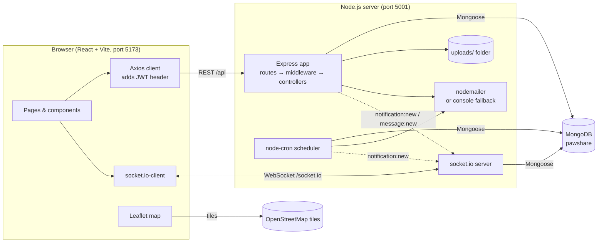
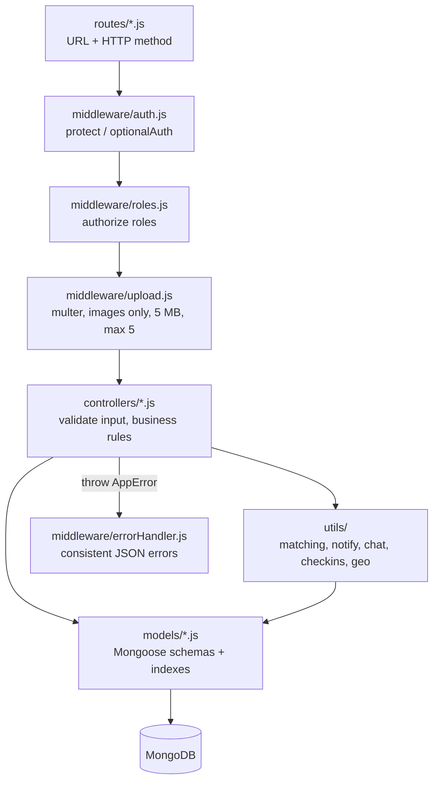
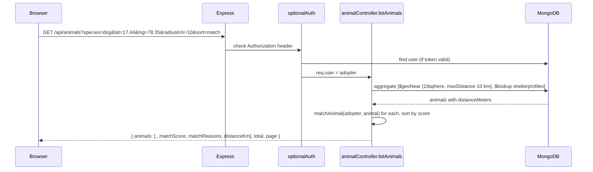
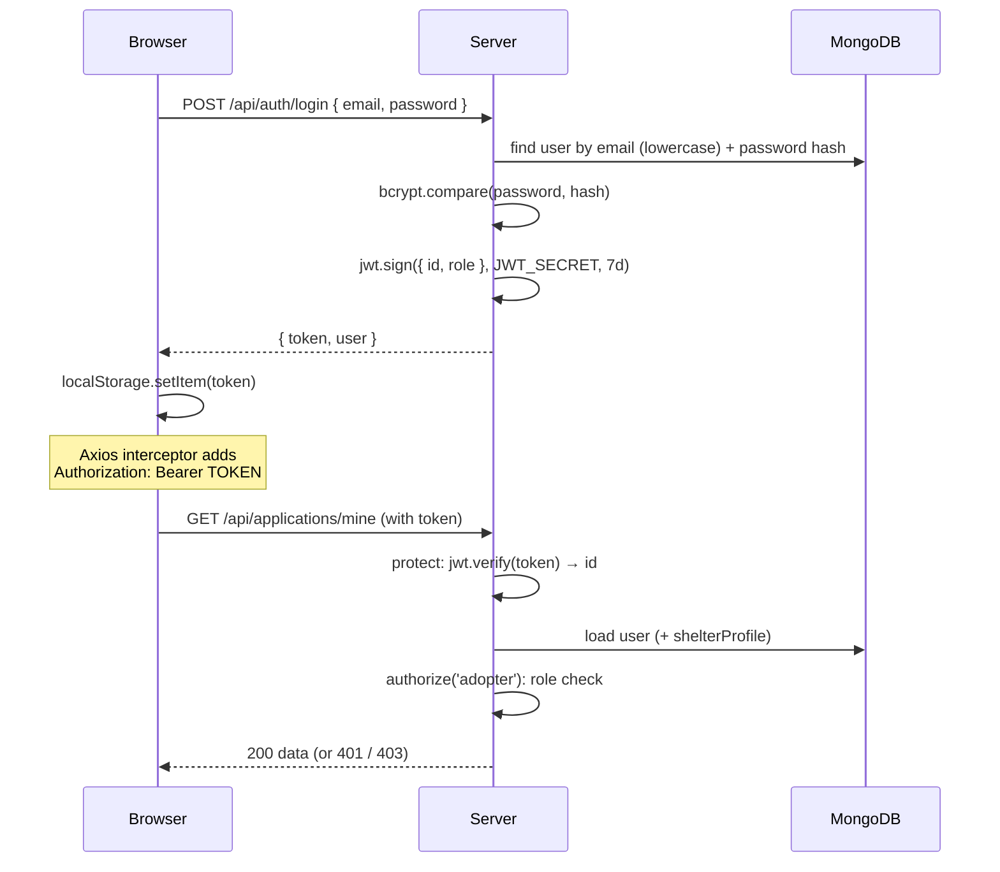
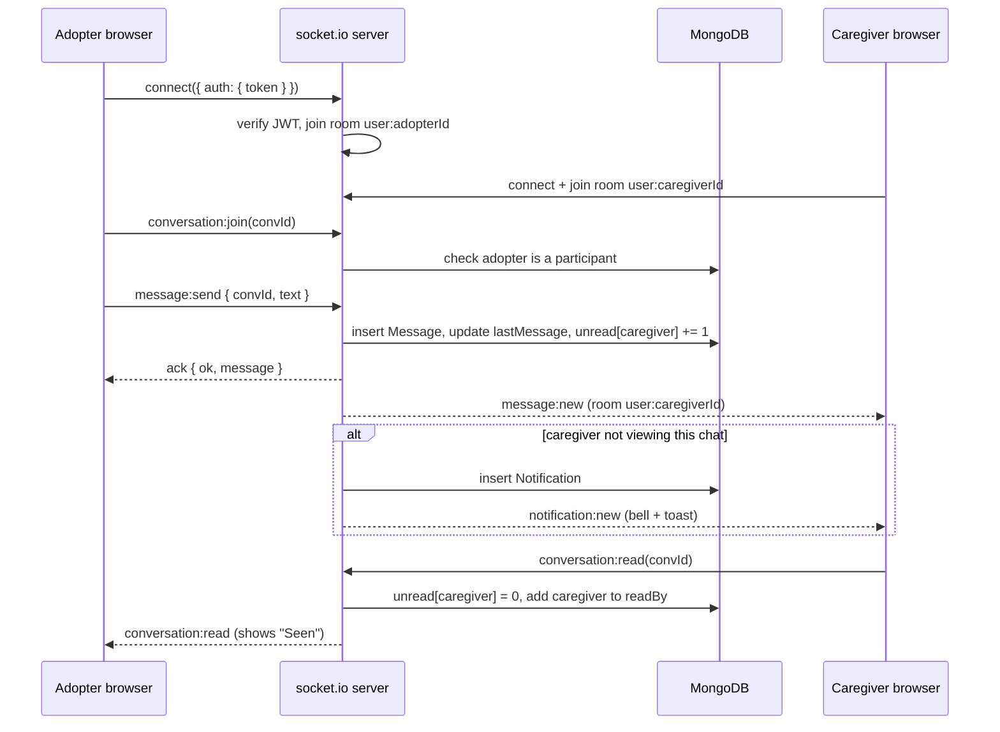
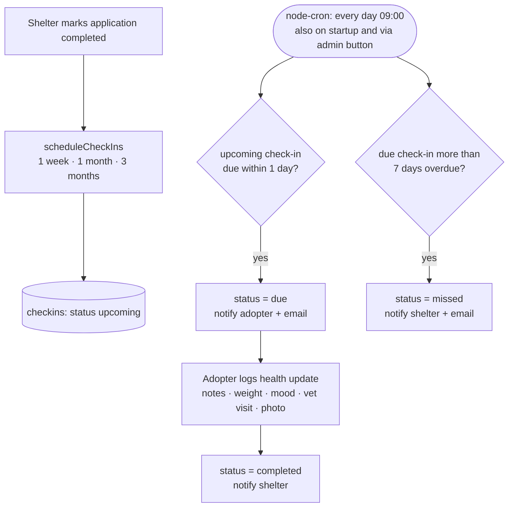
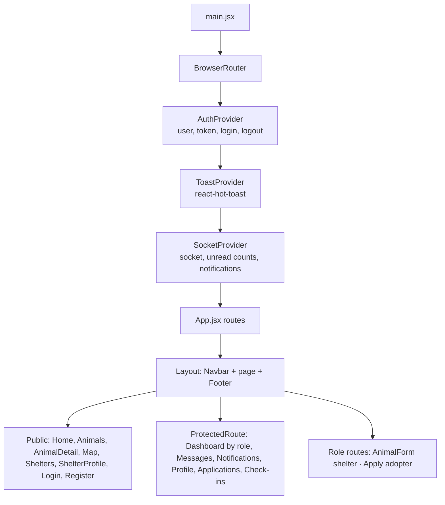

# PawShare Architecture

## System overview

- One Node.js process runs Express, socket.io and the cron job, all sharing the same HTTP server on port 5001.
- In development, Vite proxies `/api`, `/uploads` and `/socket.io` to port 5001, so the browser talks to a single origin.

## Backend layers (MVC)

| Folder | Responsibility |
|---|---|
| `models/` | Schemas, validation rules, indexes, hooks (password hashing, rating recalculation) |
| `routes/` | Map URLs to controller functions and attach middleware |
| `controllers/` | Read the request, apply business rules, return JSON |
| `middleware/` | Cross-cutting concerns: authentication, roles, uploads, errors |
| `utils/` | Reusable logic: matching score, notifications, chat, check-in scheduling, email, geo helpers |
| `socket/` | Real-time connection handling |

Express 5 passes errors thrown in `async` handlers straight to the error middleware, so controllers just `throw new AppError('message', status)`.

## Request flow example: search animals near me

## Authentication flow (JWT)

- Passwords are never stored in plain text: a `pre('save')` hook hashes them with bcrypt.
- The token only contains the user id and role, and it is signed, so it can't be forged without `JWT_SECRET`.
- If the server ever answers 401, the frontend logs out automatically.

## Real-time messaging flow (socket.io)

- Every user joins a private room `user:<id>`, so the server can push to one person on all their open tabs.
- Chat windows also join `conversation:<id>` for typing indicators and to detect whether the recipient is already looking at the chat.

## Scheduled check-ins (node-cron)

The schedule (7 / 30 / 90 days) lives in one place: `CHECKIN_SCHEDULE` in `server/utils/constants.js`.

## Frontend structure

