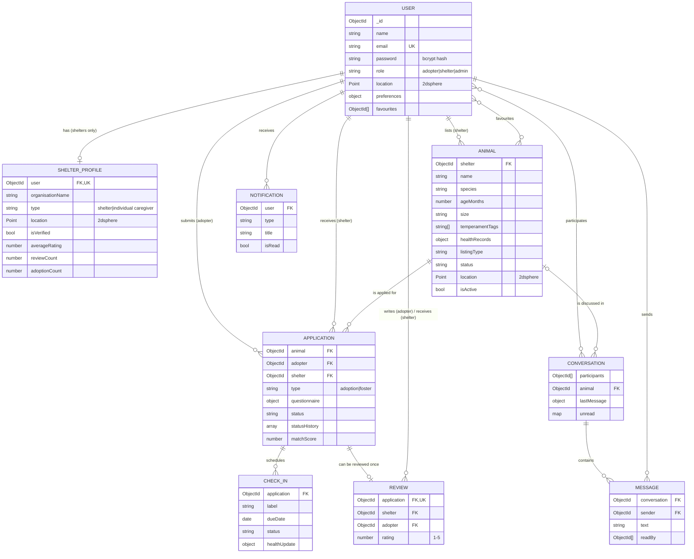

# PawShare Database Design

MongoDB database `pawshare`, modelled with Mongoose. There are 9 collections.

## ER diagram

## Collections

All collections have `createdAt` and `updatedAt` (Mongoose `timestamps`).

### users

| Field | Type | Notes |
|---|---|---|
| name | String | required |
| email | String | required, **unique**, lowercase |
| password | String | bcrypt hash (10 salt rounds), `select: false`, never returned |
| role | String | `adopter` \| `shelter` \| `admin` |
| phone, avatar, city | String | |
| location | GeoJSON Point | `{ type: 'Point', coordinates: [lng, lat] }` |
| preferences | Object | adopters: `species[]`, `sizes[]`, `ageRange {min,max}` (years), `hasKids`, `hasOtherPets`, `otherPetTypes[]`, `homeType` (apartment\|house), `hasYard`, `activityLevel` (low\|medium\|high), `experience`, `maxDistanceKm` |
| favourites | [ObjectId → Animal] | |
| shelterProfile | virtual | populated from `shelterprofiles` where `user = _id` |

Indexes: `email` (unique), `location` (**2dsphere**).

### shelterprofiles

| Field | Type | Notes |
|---|---|---|
| user | ObjectId → User | required, **unique** (one profile per shelter user) |
| organisationName | String | required |
| type | String | `shelter` \| `individual caregiver` |
| description, address, city, website | String | |
| location | GeoJSON Point | required |
| contactEmail, contactPhone | String | |
| isVerified | Boolean | default `false`, set by admin |
| verifiedAt | Date | |
| averageRating, reviewCount | Number | recalculated from `reviews` with an aggregation |
| adoptionCount | Number | `+1` when an application is completed |

Indexes: `user` (unique), `location` (**2dsphere**, used by `$near` for nearby shelters), `{ isVerified, averageRating }`.

### animals

| Field | Type | Notes |
|---|---|---|
| shelter | ObjectId → User | owner (shelter user) |
| name, breed, color, description, city | String | |
| species | String | dog \| cat \| rabbit \| bird \| other |
| ageMonths | Number | 0–360 (stored in months so age ranges are simple comparisons) |
| size | String | small \| medium \| large |
| gender | String | male \| female |
| photos | [String] | URLs like `/uploads/abc.jpg` (max 5) |
| temperamentTags | [String] | friendly, calm, energetic, playful, kid-friendly, good-with-dogs, good-with-cats, house-trained, shy, needs-experienced-owner |
| activityLevel | String | low \| medium \| high |
| healthRecords | Object | `vaccinated`, `vaccinations [{ name, date }]`, `sterilised`, `dewormed`, `medicalNotes`, `specialNeeds` |
| listingType | String | adoption \| foster \| both |
| status | String | available \| pending \| adopted \| fostered |
| location | GeoJSON Point | required, defaults to the shelter's location |
| isActive | Boolean | `false` = soft-deleted / deactivated by admin |

Indexes: `location` (**2dsphere**, used by `$geoNear` and `$geoWithin`), `{ isActive, status, species, size }`, `{ shelter, createdAt }`.

### applications

| Field | Type | Notes |
|---|---|---|
| animal, adopter, shelter | ObjectId | references |
| type | String | adoption \| foster |
| fosterDuration | String | required when `type = foster` |
| questionnaire | Object | `homeType`, `hasYard`, `hasKids`, `otherPets`, `experience`, `workHoursPerDay`, `reason` |
| status | String | submitted \| under_review \| approved \| rejected \| completed \| withdrawn |
| statusHistory | [Object] | `{ status, note, changedBy → User, changedAt }`, used for the timeline |
| shelterNotes | String | last note from the shelter |
| matchScore | Number | match % when the application was submitted |
| completedAt | Date | |

Indexes: `{ adopter, createdAt }`, `{ shelter, status }`, `{ animal, adopter }` (duplicate check).

### conversations

| Field | Type | Notes |
|---|---|---|
| participants | [ObjectId → User] | adopter + shelter |
| animal | ObjectId → Animal | optional context |
| lastMessage | `{ text, sender }` | for the inbox preview |
| lastMessageAt | Date | for sorting |
| unread | Map<userId, Number> | unread count per participant |

Index: `{ participants, lastMessageAt }`.

### messages

| Field | Type | Notes |
|---|---|---|
| conversation | ObjectId → Conversation | |
| sender | ObjectId → User | |
| text | String | 1–2000 characters |
| readBy | [ObjectId → User] | read receipts |

Index: `{ conversation, createdAt }`.

### checkins

| Field | Type | Notes |
|---|---|---|
| application, animal, adopter, shelter | ObjectId | references |
| label | String | "1 week", "1 month", "3 months" or "Health update" |
| dueDate | Date | |
| status | String | upcoming \| due \| completed \| missed |
| reminderSentAt | Date | set by the cron job |
| healthUpdate | Object | `notes`, `weightKg`, `vetVisit`, `vetNotes`, `photo`, `mood` (happy\|okay\|unwell) |
| completedAt | Date | |

Indexes: `{ status, dueDate }` (used by the cron job), `{ adopter, dueDate }`, `{ shelter, dueDate }`.

### reviews

| Field | Type | Notes |
|---|---|---|
| shelter, adopter | ObjectId → User | |
| application | ObjectId → Application | **unique**: one review per completed adoption |
| rating | Number | 1–5 |
| comment | String | |

Indexes: `application` (unique), `{ shelter, createdAt }`. A `post('save')` hook recalculates the shelter's `averageRating` and `reviewCount`.

### notifications

| Field | Type | Notes |
|---|---|---|
| user | ObjectId → User | recipient |
| type | String | application \| message \| checkin \| review \| verification \| system |
| title, body | String | |
| link | String | frontend route to open |
| isRead | Boolean | |

Index: `{ user, isRead, createdAt }`.

## Design decisions

- **ShelterProfile is a separate collection** linked one-to-one to a User. Login data stays in `users`, while public shelter data (verification, rating, location) can be queried and indexed on its own.
- **GeoJSON with 2dsphere indexes** on users, shelter profiles and animals lets MongoDB compute real distances on the Earth's surface. Coordinates are stored as `[longitude, latitude]`.
- **Soft delete** (`isActive`) keeps adoption history, check-ins and reviews intact when a listing is removed.
- **Denormalised counters** (`averageRating`, `reviewCount`, `adoptionCount`, conversation `unread`) avoid recalculating on every page load.
- **References, not embedding,** for applications, messages and check-ins, because they grow without limit.
